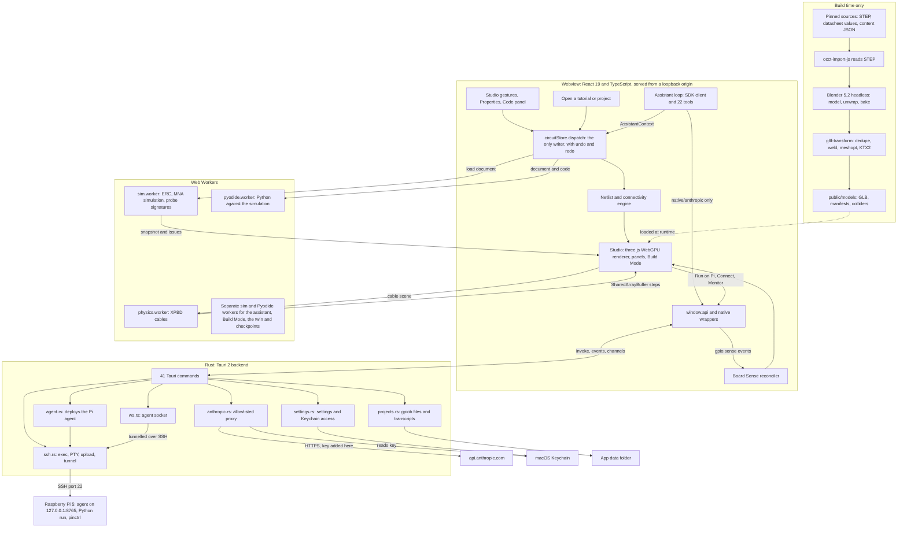

# Architecture

How GPIO Dashboard v2 ("Breadboard Studio") is put together, as the code has it. The plan is
[`docs/v2/SPEC.md`](v2/SPEC.md) section 4; where the code differs, this document follows the code and
says so in [Where the code differs from the plan](#where-the-code-differs-from-the-plan). Decisions
are cited as ADR-nnnn from [`docs/v2/DECISIONS.md`](v2/DECISIONS.md), which numbers them 0001 to 0126.
Paths are relative to `gpio-dashboard/src/renderer/src/` unless they start with `src-tauri/`,
`pi-agent/` or `scripts/`.

## 1. The system on one page



The webview holds the circuit document and everything that reads it. Heavy computation runs in Web
Workers. Rust holds the network, the SSH session, the Keychain and the file system. The Pi runs a
small Python agent that is reached only through the SSH connection. The 3D models are produced
ahead of time by scripts and shipped as files.

## 2. Process model

| Process | What runs there | How it is reached | ADRs |
| --- | --- | --- | --- |
| **Webview** (WKWebView in a Tauri 2 window) | React 19, with new code in strict TypeScript and the kept pages in JSX: the stores, `core/`, the Studio, the panels and the assistant loop | Production loads `http://127.0.0.1:<ephemeral port>`, served by `src-tauri/src/loopback.rs`; development loads Vite on `localhost:5173` | 0008 |
| **sim.worker** | `SimHost`: one document's ERC (rules plus the checks that read a snapshot), MNA simulation, probe signatures, mock Board Sense sweeps and candidate causes | `postMessage` through `simChannel()` in `state/simClient.ts`; five channels exist, each its own worker started on first use: the app's, the assistant's, Build Mode's, the live twin's and the checkpoints' | 0012, 0013, 0095, 0112, 0121, 0125 |
| **pyodide.worker** | Pyodide 314.0.7 and a `SimSession` of the circuit in the same worker, so every shim call is a direct call; virtual time | `state/pyClient.ts`; Stop and part inputs go through shared memory because Python blocks the worker | 0017, 0108 |
| **assistantPython.worker** | The assistant's own Pyodide, for its compile check and `run_code_in_sim` | `state/assistantPython.ts`, one request at a time | 0095 |
| **physics.worker** | `PhysicsHost` around a `CableWorld`: the XPBD cable solver. It sees colliders, anchors and route hints, never the document | Scene messages in, a double-buffered `SharedArrayBuffer` out (`workers/physicsTransport.ts`, `studio/cables.ts`) | 0060 to 0064, 0068 to 0081 |
| **Rust backend** | 41 Tauri commands: SSH, the agent socket, agent deployment, settings and Keychain, the Anthropic proxy, project files | `window.api`, which `api.js` builds over `invoke`, `listen` and `Channel` when running inside Tauri; typed wrappers in `native/` | 0008, 0010, 0098 |
| **Pi agent** | `pi-agent/agent.py` (WebSocket server), `gpio_monitor.py` (`pinctrl` polling at 10 Hz), `system_info.py`, `sense.py` (Board Sense), `code_executor.py` | An SSH direct-tcpip tunnel from `ws.rs` to `127.0.0.1:8765`; the agent authenticates a per-start token | 0019 |
| **Build-time tools** | Blender 5.2 LTS, KTX-Software, `occt-import-js`, gltf-transform | `scripts/assets/`, never shipped | 0005, 0020 to 0024 |

Points that shape everything else:

- **Cross-origin isolation.** The physics buffer and Pyodide's blocking sleep need
  `SharedArrayBuffer`. WKWebView grants it only to http(s) documents with COOP and COEP headers, so
  the packaged app serves its own frontend from a loopback HTTP server that sets them (and Tauri's
  CSP), and the window may navigate only within that origin. Because Tauri treats that origin as
  remote, every command needs an ACL permission: `build.rs`, `permissions/app-commands.toml` and
  `generate_handler!` in `main.rs` list the same names, and a test keeps them equal (ADR-0008).
- **The webview's only exits.** The CSP is `default-src 'self'` with `connect-src 'self' ipc:
  http://ipc.localhost`, so the page cannot open a socket to anything but its own origin and
  Tauri's IPC (`src-tauri/tauri.conf.json`).
- **Two kinds of Rust-to-webview traffic.** Global events (`gpio:state`, `gpio:system-info`,
  `gpio:sense`, `gpio:sense-event`, `terminal:data:<id>`, `tutorial:output`) fan out to listeners.
  A `Channel` carries a single request's stream: the Anthropic proxy's head, chunks and end.
- **Workers are lazy and separate on purpose.** The assistant, Build Mode, the live twin and the
  checkpoints each use their own simulation worker so that what they ask never changes what the Sim
  panel shows (ADR-0095).
- **Quitting stops the Pi agent.** `shutdown` in `src-tauri/src/main.rs` disconnects the socket,
  stops the agent over SSH and closes the connection, within five seconds.

## 3. Data flow

### 3.1 Every change goes through one writer

`state/circuitStore.ts` (`CircuitStore`, the app's one instance is `state/circuit.ts`) is the only
code that changes a `CircuitDoc` (ADR-0027). Its steps, for `dispatch`:

1. Refuse the transaction if an assistant turn owns the store and this is not that turn (`LOCKED`).
2. `applyOps` (`core/ops/apply.ts`) applies the operations and returns the new document and the
   inverse operations. An `OpError` becomes a rejected result.
3. `validateDoc` (`core/ops/validate.ts`) checks holes, spans, rigid footprints, the T-board body,
   gender mating, part properties and custom parts. Any problem rejects the transaction, and the
   document is unchanged.
4. Push the transaction and its inverse on the undo stack, bump the revision, then `commit`:
   replace the document, run `ConnectivityEngine.commit` (the union-find netlist and a typed diff,
   in `core/netlist/engine.ts`) and notify subscribers.

Undo and redo apply the stored inverse or the stored operations, so a document returns exactly. An
assistant turn's transactions undo and redo as one group (ADR-0094).

| Who writes | How |
| --- | --- |
| Studio gestures, keys, Properties | `edit(label, ops)` in `state/studioStore.ts`, which refuses tutorial templates and Build Mode and then calls `circuit.dispatch`. While a drag is in progress the Studio calls `circuit.check(...)` instead, which validates without committing and colours holes green or red (ADR-0033, 0035) |
| The Code panel | Leaving the editor dispatches one `SetCode` transaction (`panels/CodePanel.tsx`), and saving does the same first (`state/projectStore.ts`, ADR-0034). The assistant's `write_code` is also a `SetCode` operation |
| The assistant | `AssistantContext.dispatch`, which `state/assistantContext.ts` backs with `circuit.dispatch`; each transaction carries the turn's id, and the store is locked to that turn while it runs (ADR-0094) |
| Opening a project, tutorial or sample | `circuit.open(doc)`: validated, then it replaces the document and clears the history. It is not a transaction (ADR-0027, 0036, 0114) |

### 3.2 What follows a commit

Subscribers react to the new document; none of them writes to it.

- **Connectivity.** `circuit.engine` already holds the new netlist; hover highlights, picking and
  the Nets list read it. Build Mode keeps an engine of its own over the document it draws, which is
  derived from the circuit and never written back (ADR-0109).
- **ERC and simulation.** `workbenchStore.follow()` (called on every circuit change) sends
  `{type: 'load', doc}` to the app's sim worker. `SimHost` builds a `Circuit` and a `SimSession`
  and answers `{snapshot, issues, reads}`: ERC rules (`core/erc/erc.ts`) plus the checks that need a
  solution, `PIN_OVERCURRENT`, `RAIL_BUDGET` and `LED_NO_LIMIT` (`core/sim/checks.ts`). Loads run one
  at a time and a load for a replaced document is skipped (ADR-0034). The result lands in
  `useWorkbench.sim`.
- **The Studio.** `pages/StudioPage.tsx` reads the document with `useSyncExternalStore` and hands
  it to `Studio.tsx`; `studio/view.ts` draws it: instanced part bodies and leads, markers, labels. `SimVisuals` (`studio/simvisuals.ts`)
  reads the snapshot and writes LED glow, animated parts, current dashes, voltage tags and halos
  through the part handles (ADR-0047, 0052, 0053, 0056, 0058). The frame loop renders while
  something moves and then goes idle (ADR-0026, 0082).
- **Cables.** `studio/cables.ts` turns what the layers placed (collider poses, each lead's anchors,
  route hints) into a scene message for `physics.worker`; an unchanged scene is not resent. The
  worker steps on a 60 Hz clock while any island is awake, publishes each whole step into the
  buffer's idle half and flips it to the front; the Studio copies the front half once per frame
  and re-reads it if the half's generation changed (a torn read). Opening a document asks for a
  world settled offscreen for at most one second first (ADR-0068, 0070, 0071).
- **Python.** Run in Sim sends the document and the editor's code to `pyodide.worker`, which runs
  the program against its own `SimSession` in virtual time (ADR-0017).
- **Steps and wiring text.** `core/steps/steps.ts` generates the build steps and the wiring table
  from the document, so they cannot be edited apart from it.
- **Board Sense.** When the open document changes, `senseStore` asks the sim worker for the new
  predicted signature and re-compares what was measured (section 6).

### 3.3 The assistant's turn

1. The Claude drawer (`panels/ClaudePanel.tsx`) starts a turn in `AssistantSession`
   (`assistant/loop.ts`) and locks the store to the turn id.
2. The loop streams `POST /v1/messages` through the SDK, whose `fetch` is `nativeAnthropicFetch`
   (section 7). It reads the stream itself (`assistant/stream.ts`, ADR-0083), so a tool call's
   partial JSON can draw a ghost before the input completes (ADR-0096).
3. Each tool call is validated against its schema and runs through `AssistantContext`: `dispatch`
   and `check` for the document, `sim` for the assistant's own simulation worker, `checkPython` and
   `runCodeInSim` for its own Pyodide (ADR-0095), `captureView`, `focus`, `highlight` and `setGhost`
   for the Studio, `boardSense()` for a read-only copy of the Board tab, and `askUser`.
4. A rejected operation comes back to the model as a tool result and changes nothing. Accepted ones
   commit with the turn's id; the Studio shows the review strip, and Undo all calls
   `circuit.undoTurn`. The loop's tool list, strict subset and eager streaming are ADR-0084, 0085,
   0105; the tool order is fixed for a conversation (ADR-0087); how a turn ends is ADR-0088.
5. The turn ends, the store unlocks, and the transcript is written beside the project by
   `projects_write_transcript` (ADR-0098).

### 3.4 Run on Pi

`runOnPi` in `state/runStore.ts`: the ERC of the document with its code runs first and errors open
an override dialog; with Board Sense on, `senseStore.pauseForRun` asks the agent to release its
lines and the run refuses to start without the acknowledgement within one second; the program is
uploaded to `/tmp/gpio_dashboard/project_<id>.py` (`ssh_scp_buffer`), run with `python3 -u`
(`ssh_run_tutorial_script`) and its output returns as `tutorial:output` events. Stop kills the
process and returns the program's pins to inputs. The run has no fixed deadline unless a time limit
is set in settings (ADR-0125 describes how the checkpoints reuse this path).

## 4. Module boundaries and the lint rules that hold them

The rules are in `eslint.config.mjs`, and `boundaries.test.ts` checks that they exist as errors
and that sample files with forbidden imports fail while allowed ones pass.

| Module | Role | May not import | Rule |
| --- | --- | --- | --- |
| `core/` | Pure TypeScript: model, ops, netlist, ERC, sim, steps, reach, sense, geometry, serialization | `react`, `react-dom`, `three`, `@react-three/*`, `@tauri-apps/*`; `api`, `native/`, `state/`, `store/`, `studio/`, `panels/`, `components/`, `pages/`, `workers/`, `assistant/`, `physics/`; the globals `window`, `document`, `navigator`, `localStorage`, `sessionStorage`; `window.api` | `no-restricted-imports`, `no-restricted-globals`, `no-restricted-syntax` |
| `physics/` | The cable solver, visual only | The same UI and Tauri packages; `api`, `native/`, `state/`, `store/`, `studio/`, `panels/`, `components/`, `pages/`, `workers/`, `assistant/`; `core/ops/` and `core/serialize/` (so it cannot dispatch); the DOM globals; `window.api` | the same three |
| `assistant/` | The Claude loop and tools | The UI and Tauri packages; `api`, `state/`, `store/`, `studio/`, `panels/`, `components/`, `pages/`, `workers/`, `physics/`; every `native/` module except `native/anthropic`; the DOM globals; `window.api` | the same three |
| `studio/` | The 3D stage | `WebGLRenderer` from `three`; `@react-three/drei` | `no-restricted-imports` |

What this guarantees:

- **The core is portable and testable.** Anything in `core/` runs unchanged in Node (the evals and
  the Vitest suite), in a worker, or in the page.
- **Physics cannot change a circuit.** It has no import path to the dispatcher, so cables never
  alter electrical results (SPEC 21).
- **The assistant has no path to hardware.** It imports only `core/`, `native/anthropic` and the
  `AssistantContext` interface in `assistant/context.ts`, which has no member for SSH, GPIO, the
  terminal or project files. The Claude panel and `state/assistantContext.ts` implement and inject
  it. The same rule keeps `assistant/` away from `state/checkpointStore.ts`, whose buttons run code
  on the Pi (ADR-0125).
- **One renderer.** The Studio draws with `WebGPURenderer` and TSL only; `drei`'s helpers build on
  GLSL material and are excluded (SPEC 10.2; the frame and post pipeline are ADR-0025, 0026).

Conventions not enforced by an import rule: new React code avoids `useEffect` (ADR-0006, which
lists the replacements), new modules are strict TypeScript 6 (ADR-0003, 0007), and a new Tauri
command is added in three places (ADR-0008). `window.api` is reachable from UI handlers and from
the kept JSX components; the `native/` wrappers cover `anthropic`, `projects`, `sense`, `settings`
and `ssh`, and the JSX pages for connect, pinout and monitor call `window.api` directly.

## 5. The asset pipeline: STEP and Blender to GLB

`npm run assets:build` regenerates every shipped model headlessly from committed scripts and
pinned sources; `npm run assets:check` verifies the committed files (`scripts/assets/README.md`
has the runtime contract).

1. **Pinned sources** (`scripts/assets/sources.ts`, `sources.json`): each download has a URL, a
   SHA-256 and a licence, and is cached in `~/.cache/gpio-dashboard-assets/`. They are the Pi 5's
   no-graphics STEP (MIT), two Adafruit STEP files (MIT) and the studio HDRI (CC0).
2. **STEP to an intermediate GLB** (`step-to-glb.ts`): `occt-import-js` (OpenCascade compiled to
   WASM) reads a STEP, because Blender has no STEP importer. The Pi's STEP is read in parts to stay
   inside a 2 GB heap (ADR-0020).
3. **Blender, headless** (`blender/<asset>.py`, run through `BLENDER_BIN`, with shared helpers in
   `blender/lib/`): model or adapt, assign materials, unwrap, and bake ambient occlusion with
   Cycles at fixed samples and seed. The Pi 5 starts from its STEP. Breadboards, the T-board, the
   IDC sockets, the ribbon's texture maps, the Dupont housings and the part bodies are modelled from
   datasheet values and the content JSON (two parts, the DC motor and the ADS1115 module, adapt
   Adafruit STEP files); the part models go through a registry (`scripts/assets/parts.ts`,
   ADR-0029 to 0032, 0043 to 0046).
4. **Optimize** (`optimize.ts`, gltf-transform): dedupe, weld, prune, KTX2 textures (ETC1S for
   colour, UASTC for normal and occlusion) and meshopt compression. KTX2 goes through `ktx create`
   (ADR-0005, 0022).
5. **Write** (`build.ts`): `public/models/<name>.glb`, `<name>.manifest.json` (tool versions,
   script and input hashes, sources, budgets, geometry hash) and `<name>.colliders.json`. A GLB
   over its budget is refused. The scripts run on Node's type stripping through a small resolve hook
   (ADR-0023).
6. **Check** (`check.ts`, `verify.ts`, guarded in Vitest by `content/models.test.ts`): every
   breadboard hole is measured from the GLB against `holePosition`, every part's pin empties against
   its definition's grid, the Pi's mounting holes and header base against `pi5-board.json`, plus
   hashes, budgets and KTX2 formats. `--rebuild` rebuilds into a temporary folder and compares
   geometry hashes and texture similarity.

At run time `studio/loaders.ts` loads the GLBs with a meshopt decoder and a KTX2 loader (the Basis
transcoder is shipped in `public/basis/`). Models are instanced once per file with a handle per
copy (ADR-0047); part pins come from `pin-<id>` empties, the Pi's 40 header pins are instanced from
`pi5-header.json` because they are not in `pi5.glb`, and the colliders feed the physics worker.
Units are millimetres and the glTF frame is y up, so a core point `(x, y, z)` is `(x, z, -y)` in the
scene. The geometry the Studio draws comes from the same data files as the logical holes and pins,
and tests prove they coincide (ADR-0030, 0037 to 0041, 0065, 0066).

## 6. Board Sense, end to end

Board Sense answers "which GPIOs are joined on my real board" using only the Pi's inputs and
internal pulls. The agent measures; the app interprets.

1. **Switch on.** In the Board tab (`panels/BoardPanel.tsx`) the user turns sensing on. `senseStore.start`
   asks the sim worker for the open document's predicted `ProbeSignature` (`core/sim/probe.ts`), builds
   a `Reconciler` (`core/sense/sense.ts`) and, in Pi mode, calls `startSensing(pins)` in
   `native/sense.ts`. Nothing else starts sensing.
2. **Webview to Rust.** `api.js` invokes `sense_start`. `commands::sense_start` accepts only GPIOs 2
   to 27 and bounds the timing, then `Ws::send` writes `{type: 'sense_start', config}` to the agent
   socket.
3. **Rust to the Pi.** The socket is a `russh` direct-tcpip channel to `127.0.0.1:8765` on the Pi
   (`Route::Tunnel` in `src-tauri/src/ws.rs`), authenticated with the token the agent printed at start.
4. **Measure.** `pi-agent/sense.py` takes each probed line as an input only: per pin a read under
   the pull-up and under the pull-down; per driving pin, with the others precharged through their
   opposite pull and then floated, a read of which follow. Lines are requested in one place, as
   inputs with bias set to up, down or disabled; GPIO0, GPIO1, pins outside 2 to 27 and pins an
   alternate function or another process owns are skipped; every line is released at the end of each
   sweep. The agent sends `sense_sweep` with raw levels, and `sense_event` for errors (ADR-0013, 0018,
   0019).
5. **Back to the page.** `ws.rs` `forward` drops a sweep that repeats the last except for its
   timestamp and emits `gpio:sense`; `api.js`, `native/sense.ts` and `senseStore.take` hand it to
   `Reconciler.onSweep`.
6. **Interpret.** `core/sense` reads the levels as bias classes and pair readings, settles a net's
   state over two sweeps, compares it with the prediction, and emits events and divergences.
   Divergences are ranked by `rankCandidates` (`core/sense/candidates.ts`), which simulates
   single-fault edits of the document (a part reversed, a part or lead end one row off, a lead on the
   wrong rail) in the sim worker and scores each against the measurement; candidates with identical
   signatures are reported as a tie. A net whose observability cannot be established is reported
   unobserved.
7. **Show.** The Board tab lists net states, events and causes. The Studio tints strips and, on a
   diverged net, shows a badge that opens a card with the ranked causes (`state/badges.ts`,
   ADR-0123). Build Mode judges a step by comparing the latest sweep with signatures computed once
   per step (`core/sense/buildSteps.ts`, ADR-0112, 0116 to 0118). The assistant gets a read-only
   copy through `AssistantContext.boardSense()`; it cannot start or configure sensing.
8. **Before a run.** `pauseForRun` sends `sense_pause`; `Ws` waits up to a second for `sense_paused`,
   which the agent sends only after every line is released, and the run refuses to start without it.

Mock mode runs the same reconciler against `mockSweep`, a simulation of a physical board document in
the sim worker, so everything but the Pi can be exercised without one. Presence sensing (a lead that
touches nothing) is not built (ADR-0018).

The live twin is a separate read-only path on the same connection: `state/liveStore.ts` reads the
telemetry store (`gpio:state`: the agent samples about ten times a second and `ws.rs` drops a frame identical to the last), `liveSim` solves the
document with the Pi's real pin states, `liveCheck` compares them with what the document and code
expect, and `studio/livepins.ts` paints the pins (ADR-0120 to 0122).

## 7. The key's path

Inside the app the Anthropic API key exists in three places only: the macOS Keychain, the memory
of the Rust process during a request, and a Settings text field from the moment it is typed until
the user presses Save, which hands it to Rust once and clears the field. After that it never
returns to the webview.

```
Settings field  --setKey-->  settings_set_anthropic_key  -->  Keychain
                                                              (service com.gpio-dashboard, item anthropic.apiKey)

SDK request  -->  nativeAnthropicFetch  -->  anthropic_request (Channel)  -->  Rust proxy  -->  api.anthropic.com
 (placeholder key)                            path and method allowlist        reads the key
                                                                               from the Keychain
```

1. **Saving.** `panels/AssistantSettings.tsx` reads an uncontrolled field once on Save, clears it and
   hands the value to `native/anthropic.setKey`. No state holds it. A chat message that looks like a
   key is not sent. The save, `hasKey` and `clearKey` commands return booleans; no command returns the
   key (ADR-0098; the `no_anthropic_key_command_returns_the_key` test).
2. **Requesting.** `assistant/client.ts` builds the SDK with `apiKey: 'placeholder-the-proxy-adds-the-real-key'`,
   `dangerouslyAllowBrowser: true` (safe only because the real credential is added elsewhere) and
   `fetch: nativeAnthropicFetch`. That function sends `{id, method, path, headers, body}` through
   `anthropic_request` and rebuilds a streaming `Response` from the Channel's head, chunks and end.
3. **The proxy** (`src-tauri/src/anthropic.rs`) allows `POST /v1/messages`, `POST
   /v1/messages/count_tokens` and `GET /v1/models` (with a plain query), and refuses everything else.
   It takes four headers from the webview (`anthropic-version`, `anthropic-beta`, `content-type`,
   `anthropic-workspace-id`) and drops the rest, including any `Authorization` or `x-api-key` the
   page set, then adds the key from the `KeyProvider` as the authorization header, marked sensitive.
   Redirects are not followed, so the key cannot leave for a path the allowlist never approved;
   `Set-Cookie` is not passed back. The workspace-id header is ADR-0010.
4. **The page cannot bypass it.** The CSP leaves the webview no route to the API (section 2), and
   the assistant's `native/` imports are limited to `native/anthropic` by lint (section 4).
5. **Outside the app.** Two kinds of process read the key from a git-ignored `.env`, into their own
   memory only: the live assistant evaluations and one ignored Rust test of the proxy
   (`npm run evals:live`, `npm run evals:proxy`; ADR-0102). Recorded evaluation runs are scrubbed of
   keys and opaque tokens before they are committed (ADR-0101).
6. **Saved transcripts** pass through `redact_keys` in `src-tauri/src/projects.rs`, which masks
   anything shaped like a key before writing (ADR-0098).

The SSH password is a different case, kept as it was before v2: it is stored in the Keychain under
`connection.password` and returned by `settings_get` so that the Connect form can fill its field.

## Where the code differs from the plan

- **Tutorials and projects open with `circuit.open`,** which validates the document and clears the
  history; it is not an undoable transaction as SPEC 1 describes (ADR-0027, 0114).
- **`core/` is not tied to one thread.** SPEC 4.1 draws the simulation in a worker; the same pure
  modules also run on the main thread (the connectivity engine, step generation, the ERC in
  `workbenchStore`) and in the Pyodide worker.
- **`native/` has fewer wrappers than SPEC 4.4 lists:** `anthropic`, `projects`, `sense`, `settings`
  and `ssh`. The pages kept from version 1 call `window.api` directly.
- **More workers than the plan names:** five simulation channels and a second Pyodide worker, for
  the assistant, Build Mode, the live twin and the checkpoints (ADR-0095, 0112, 0121, 0125).
- **Open and unverified.** What the Pi and the bench must confirm is in
  [`docs/v2/HIL_CHECKLIST.md`](v2/HIL_CHECKLIST.md); the frame rate on the heaviest tutorial under
  physics, measured at 55 to 58 fps in the Tauri window, is recorded in
  [`docs/v2/PROGRESS.md`](v2/PROGRESS.md) (M8).

## Decision index

| Area | ADRs |
| --- | --- |
| Process model, webview origin, CSP, commands | 0008, 0010, 0098 |
| Toolchain, lint, TypeScript, no `useEffect` | 0003, 0005, 0006, 0007, 0023 |
| One store, gestures, undo, locking, custom parts | 0027, 0033 to 0036, 0090 to 0094 |
| Geometry and electrical constants | 0004, 0009, 0011, 0042 |
| ERC and simulation | 0012 to 0015, 0107 |
| Code in the loop | 0016, 0017, 0108 |
| Board Sense | 0013, 0018, 0019, 0112, 0116 to 0119, 0123 |
| Studio rendering | 0025, 0026, 0047, 0052 to 0059, 0067, 0082 |
| Physics | 0060 to 0064, 0068 to 0081 |
| Assets | 0020 to 0024, 0029 to 0032, 0037 to 0046, 0065, 0066 |
| Assistant | 0083 to 0089, 0095 to 0099, 0105, 0106 |
| Evaluations | 0100 to 0104 |
| Build Mode | 0109 to 0115 |
| Hardware twin and checkpoints | 0120 to 0126 |
