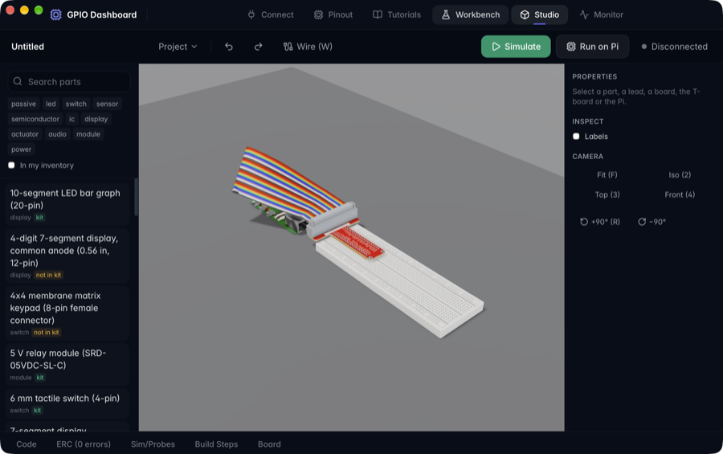
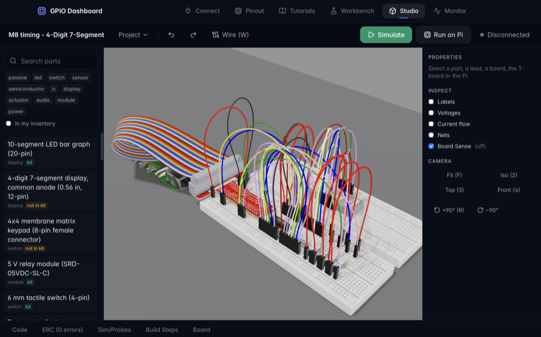

# GPIO Dashboard

### A desktop bench for the Raspberry Pi 5: a modelled breadboard in 3D, a circuit simulator, and a Claude assistant that builds circuits


**GPIO Dashboard** (version 2, "Breadboard Studio") is a desktop app for learning electronics on a Raspberry Pi 5 with the SunFounder Basic Starter Kit and a solderless breadboard. It models the bench itself: the breadboard, the Pi 5, the 40-pin T-board on its rainbow ribbon cable, the jumper leads and 38 parts, with dimensions and electrical limits taken from datasheets, the official Raspberry Pi documentation and the Pi 5's STEP file, and every lead seated in a hole that exists. One circuit document drives the rest: the netlist, the electrical rule checks and a modified-nodal-analysis simulation are computed from it, the build steps and wiring tables are generated from it, and the Python that runs in the simulator or on the Pi is checked against it. A Claude assistant builds and edits circuits through typed tools, and a link to the Pi runs the project's code and reads the real board's connectivity back.

The engineering rule behind it is that ground truth is computed, never asserted. The language model decides intent and topology; deterministic code owns geometry, connectivity, validation and electrics, and the assistant quotes the numbers those return. Every edit to a circuit, whether from a mouse gesture, the assistant, the code editor or undo, goes through one validated dispatcher, and hardware stays behind the user's own click.

> **Status.** The features below exist in the code and are covered by the automated tests under [Testing](#testing). The version 2 features have not been run against a real Pi 5: no Pi was reachable while it was built (`PI_HOST` unset), so the hardware paths are tested against mock servers and a throwaway local `sshd`. Every check that needs the Pi or the bench is listed, with no item ticked, in [`docs/v2/HIL_CHECKLIST.md`](../docs/v2/HIL_CHECKLIST.md). Milestone-by-milestone evidence is in [`docs/v2/PROGRESS.md`](../docs/v2/PROGRESS.md), the specification is [`docs/v2/SPEC.md`](../docs/v2/SPEC.md), and the design is described in [`docs/ARCHITECTURE.md`](../docs/ARCHITECTURE.md). macOS is the only platform it has been built and run on.

<p align="center">
  
  
</p>
<p align="center"><sub>The Studio's own renders, from the app window. Left: the default bench. Right: a tutorial circuit, its leads settled by the cable solver.</sub></p>

---

## Table of Contents

- [Motivation](#motivation)
- [What it does](#what-it-does)
- [What needs your hardware or account](#what-needs-your-hardware-or-account)
- [Safety and correctness](#safety-and-correctness)
- [Architecture](#architecture)
- [Technical highlights](#technical-highlights)
- [Tech stack](#tech-stack)
- [Project scale](#project-scale)
- [Getting started](#getting-started)
- [Testing](#testing)
- [Building](#building)
- [Not built, and open](#not-built-and-open)
- [Documentation](#documentation)

---

## Motivation

A breadboard circuit that does not work gives almost no feedback. The Pi will not say that an LED has no resistor, that a lead sits one row off, or that a sensor's 5 V output is about to meet a 3.3 V GPIO, and a tutorial that is wrong in one of those ways teaches the wrong lesson at best. The first version of this app drew a flat two-dimensional breadboard, and an audit of it ([`docs/v2/AUDIT.md`](../docs/v2/AUDIT.md)) recorded 242 rows (findings and the 18-item defect register), 11 of them marked unsafe for hardware: a buzzer driven straight from a GPIO at nearly twice a pin's rating, a four-digit display whose digit pins would carry 35 to 40 mA against 16 mA, and an ultrasonic sensor whose 5 V echo output needs a divider the diagram never wired. Ten of its eighteen tutorial diagrams drew no components at all.

Version 2 starts from that audit. Each of the 26 tutorials was rebuilt as a circuit document from the kit's own pages, the part datasheets and the official Raspberry Pi documentation, and must pass the rule check, its simulation assertions and a code-versus-wiring check on every test run. Only then does it get a 3D bench, an assistant and a hardware twin, so those are built on content that has been checked rather than copied.

---

## What it does

The app has six tabs: **Connect**, **Pinout**, **Tutorials**, **Workbench**, **Studio** and **Monitor**, plus a terminal panel (Ctrl/Cmd + backtick).

### Studio: the bench in 3D

- **The bench.** A bb-830 (63 rows) or bb-400 breadboard, the Pi 5, the T-board, an IDC socket and ribbon cable, Dupont and solid jumper leads, and the 38 parts. Each model is a GLB built headlessly from committed scripts and pinned sources ([asset pipeline](../docs/ARCHITECTURE.md#5-the-asset-pipeline-step-and-blender-to-glb)); a test measures the holes in the model against the logical holes.
- **Building by hand.** Drag a part from the library: free holes glow green and taken ones red, judged by the same validation the document uses. A wire tool (W), schema-driven Properties (resistor bands, LED colour, and so on), Undo and Redo, and camera presets.
- **Real-time cables.** The ribbon and every flexible lead are simulated in a worker with an in-house XPBD solver. Drag the Pi, a board, the T-board, a module or a lead end, and the cables follow, drape over what is under them and settle, then the scene stops rendering.
- **Inspect.** Hole labels, per-net voltages, current flow dashes (from Kirchhoff's current law over the simulation), a net list, ERC halos on parts over their rating, and parts animated from the simulation: LEDs glow, and a servo horn, relay armature, motor rotor and LCD text follow their part's state.
- **Rendering.** three.js `WebGPURenderer` with node (TSL) materials, ambient occlusion, bloom and temporal anti-aliasing, tone-mapped with AgX. It uses WebGPU where the webview offers it (the Tauri window of the development Mac did) and three's WebGL2 fallback otherwise. Frames are drawn while something moves, plus a few to settle, and none after that.

### Circuit core: netlist, rules and simulation

- **Netlist and connectivity.** A union-find netlist over breadboard strips, rails, the T-board and leads, updated per change with typed events down to the hole.
- **Electrical rule check.** 17 rules, each covered by tests, including `OVERVOLTAGE_GPIO` (a 5 V net on a GPIO), `LED_NO_LIMIT`, `BJT_NO_BASE_RESISTOR`, `INDUCTIVE_NO_DRIVER`, `PIN_OVERCURRENT` (16 mA), `RAIL_BUDGET` (50 mA across all GPIOs), `FLOATING_INPUT`, `LEAD_TOO_SHORT` and `CODE_PIN_MISMATCH`.
- **Simulation.** A modified-nodal-analysis solver (dense LU, Newton with limiting and gmin stepping, backward Euler then trapezoidal) with models for every library part and 15 behaviour models for modules and ICs (HC-SR04, DHT11, 74HC595, L293D, ADS7830, an HD44780 behind a PCF8574, and others). 22 reference circuits are checked against ngspice 47 within 2 %.

### Code in the loop

- **Run in Sim.** The project's Python runs in Pyodide against the simulated circuit, in virtual time, with `RPi.GPIO`, a gpiozero subset and `smbus` shims. It paces at real time, 10x or as fast as possible, and Stop interrupts it as Ctrl+C does.
- **Run on Pi.** Uploads the program to the Pi, streams its output and stops it on request, returning the pins it used to inputs. ERC errors block a run unless you override them.
- **Code panel.** CodeMirror with line and column diagnostics from a compile check.

### Tutorials and Build Mode

- **26 tutorials**: the kit's 17 projects in the kit's order, then nine extras, six of which are tagged "needs parts not in the kit" (4-digit 7-segment, servo, PIR, ultrasonic, keypad, joystick).
- **Generated, not typed.** Each tutorial is a circuit document plus theory text. Its wiring table and 411 build steps in total (each with a "why" and a common mistake where one is annotated) are generated from the document.
- **Build Mode** plays a tutorial or project step by step in the Studio: the next holes are ringed, the camera frames them and the bench shows what is built so far. Tutorials open as read-only templates and fork into projects. Progress is kept per project in browser storage.
- **Held back.** The LCD1602 tutorial is not shipped: its 5 V backpack puts about 3.8 V on GPIO2 and GPIO3, and a safe build needs an I2C level shifter the kit does not have (audit finding `lcd1602-1`).

### Claude assistant

- **Builds from a sentence.** "Blink an LED on GPIO17" in the drawer's **Claude** tab places parts and leads on the bench, writes the code and checks its own work with ERC and a simulation; in the live evaluation that finished ERC-clean in one turn. Parts appear as ghosts while a tool call is still streaming and become physical when it commits.
- **22 tools**: circuit state, part search, custom parts, boards, placement, wiring, ERC, simulation, code, a view capture, Board Sense (read only), focus and highlight, build-step annotations and a question to the user. Web search and web fetch are optional.
- **One undo.** A turn's changes undo together ("Undo all" restores the earlier document exactly). While a turn runs, the bench is read-only and Stop is always in sight.
- **Evaluated.** Twelve recorded prompts replay offline (`npm run evals`): a blink, a button toggle, a parking sensor (the HC-SR04 echo goes through a divider; wired directly it is caught by `OVERVOLTAGE_GPIO` and fixed in the same turn), undo, a second button, an RGB LED, a transistor-driven buzzer, a potentiometer ADC, a Board Sense debugging session, an explanation and a datasheet lookup. Live, eleven of the twelve scored fully; the datasheet prompt scored 11 of 14 because the account's organization refused web search ([`docs/v2/EVALS.md`](../docs/v2/EVALS.md)).

### Board Sense and the hardware twin

- **Board Sense** infers which GPIOs are joined on the real board by changing only the bias of input lines. Per pin it reads with the pull-up, then the pull-down; per driving pin it lets one pin take a pull while the others float and reads which of them follow. The app compares the result with what the document predicts and reports changes, divergences and ranked likely causes, each a single fault tried on the document (a part reversed, a part or lead end one row off, a lead on the wrong rail). It is off until switched on, and it also runs against a simulated board, with no Pi. A strip's five holes are one electrical node, so the measurement localizes to a strip; naming the hole is a ranked guess.
- **Live Pi state** (an Inspect toggle) paints the Pi's header pins and the T-board strips from telemetry, lights the bench from the real pin levels, and badges four kinds of divergence between the Pi and the document.
- **Build Mode confirmation and checkpoints.** Where a step's wiring is electrically observable, Board Sense confirms it; steps that cannot be observed are labelled "not electrically verifiable". Most are: on a full probe of the shipped tutorials, 10 of the 411 steps confirm and the rest are not electrically verifiable ([ADR-0116](../docs/v2/DECISIONS.md); the two slowest tutorials' probes run only with `FULL_PROBE=1`). Hardware checkpoints (an I2C scan, press the button, toggle an LED) run only on a click.

### The Pi link

- **Connect** over SSH (key or password) and deploy, install and start the small Python agent from the same tab. Once a connection is saved, the app connects at launch and starts the agent when the Pi already has this version's.
- **Pinout**: the 40-pin header with each pin's name, BCM and WiringPi numbers and RP1 functions, checked against the official Raspberry Pi documentation and the RP1 datasheet.
- **Monitor**: live pin levels, modes and pulls from `pinctrl`, plus temperature, memory, disk and uptime, sampled by the agent (pins at 10 Hz, system information every 5 s). The agent listens only on the Pi's loopback address; the app reaches it through the SSH connection.
- **Projects** are `.gpiob` files in the app's data folder, with import and export. The assistant's transcript is saved beside its project.

---

## What needs your hardware or account

| Feature | What it needs |
| --- | --- |
| Studio, Workbench, simulation, ERC, Build Mode, tutorials, projects, Board Sense on a simulated board, replayed evals | Only this app. No Pi, no account, no network. |
| Claude assistant | An Anthropic API key, added in the Claude tab's **Settings**. It is saved in the macOS Keychain, and once saved it never returns to the webview. Each turn costs API tokens. |
| Web search and web fetch in the assistant | The Settings toggle is on by default, but the API accepts web search only if the key's organization allows it. When a request is refused, the app drops the web tools and continues without them ([ADR-0106](../docs/v2/DECISIONS.md)). |
| Connect, Monitor, Run on Pi, the terminal | A Raspberry Pi 5 on Raspberry Pi OS with SSH enabled. |
| Board Sense, Live Pi state, Build Mode checkpoints | The Pi with the agent running, and (for Board Sense and the checkpoints) your bench wired as the document says. |

---

## Safety and correctness

- **Hardware stays behind a click.** Only a click on Run on Pi, a checkpoint button or the Board Sense toggle runs code on the Pi or touches a pin. The assistant has no path to hardware: the interface it works through has no hardware members, and a lint rule keeps it from importing the SSH, GPIO, terminal or project-write modules.
- **Once saved, the Anthropic key never returns to the webview.** You type it into a Settings field once, which hands it to Rust and clears the field. The SDK is built with a placeholder key. Every request goes through a Rust command that allows three endpoints (`POST /v1/messages`, `POST /v1/messages/count_tokens`, `GET /v1/models`), forwards four request headers, adds the key from the Keychain, refuses redirects and streams the reply back. No command returns the key, only whether one is saved. A key pasted into the chat is refused, and Rust redacts anything shaped like a key from saved transcripts. The page's CSP allows connections only to its own origin and Tauri's IPC, so it could not call the API directly anyway.
- **ERC gates Run on Pi.** An ERC error blocks a run until you override it. The assistant's circuits are checked the same way: every operation is validated before it commits, and an invalid one is rejected and leaves the document unchanged (fuzz-tested).
- **Board Sense cannot drive a pin.** The agent builds every line request as an input in one place and skips GPIO0 and GPIO1, pins outside 2 to 27, and pins with an alternate function or an owner. Lines are released at the end of every sweep, and a run on the Pi waits for the agent to confirm the release.
- **The Pi agent is loopback-only.** It binds `127.0.0.1`, authenticates with a token generated at start-up, and is reached through an SSH tunnel.
- **SSH host keys are trusted on first use**, like OpenSSH's `accept-new`. The first connection to a host and port records its key in `known_hosts` in the app config directory (`~/Library/Application Support/com.gpio-dashboard/` on macOS); later connections must present the same key. A changed key is refused with a message naming the file and line, and is never retried automatically. After reinstalling a Pi, delete that line to connect again. Servers that present a host certificate are refused, since the certificate authority is not checked.
- **The saved SSH password lives in the Keychain** and is read back to fill the Connect form.
- **Documented, not guessed.** Every dimension, pinout and electrical limit is recorded with its source: datasheets, the official Pi documentation and the Pi 5 STEP file. The T-board and the jumper leads have no published drawing, so their geometry comes from calibrated measurements of product photographs, and the open points are on the hardware checklist.

---

## Architecture

```
                 ┌──────────────────────────────────────────────┐
                 │  Webview: React 19 + TypeScript              │
  gestures ─┐    │                                              │
  assistant ┼──► │  circuitStore.dispatch  (the only writer)    │
 code edits ┘    │     │ validates, commits, can undo           │
                 │     ▼                                        │
                 │  core/  netlist · ERC · sim · steps · sense  │     workers:
                 │     │                                        │     sim · pyodide ·
                 │     ▼                                        │     physics · assistant
                 │  Studio (three.js WebGPU) · panels · drawer  │
                 └─────────────┬────────────────────────────────┘
                   invoke · events · channels
                 ┌─────────────▼────────────────────────────────┐
                 │  Rust (Tauri 2): ssh · ws · agent deploy ·   │
                 │  Anthropic proxy · projects · settings       │
                 └───────┬───────────────────────────┬──────────┘
                    HTTPS│                      SSH  │ (exec, PTY, tunnel)
              api.anthropic.com        Raspberry Pi 5: Python agent on 127.0.0.1
```

The full diagram, the data flows and the module boundaries are in [`docs/ARCHITECTURE.md`](../docs/ARCHITECTURE.md). In short:

- **One writer.** `circuitStore.dispatch` is the only code that changes a circuit document, so gestures, the assistant and undo cannot disagree. An assistant turn locks the store to itself while it runs.
- **Pure core.** `core/` and `physics/` import nothing from React, the DOM, Tauri or `window.api`; ESLint enforces it, and a test proves the rules exist and reject what they should.
- **Heavy work in workers.** The simulator, Pyodide, the cable solver and the assistant's own simulator and Python run off the main thread. The cable solver shares positions with the renderer through a double-buffered `SharedArrayBuffer`, which needs cross-origin isolation (the packaged app serves its frontend from a loopback origin that sets the headers).
- **Rust owns the network and the Keychain.** SSH, the agent socket and the Anthropic proxy are Rust commands; the webview reaches them through a typed wrapper layer, and its CSP allows no other connection.

---

## Technical highlights

- **One document, many views.** Instructions, 3D view, ERC, simulation and code are derived from or checked against one `CircuitDoc`; a test cross-checks every tutorial's code pins against its netlist.
- **A single-writer dispatcher with exact undo.** Every operation records its inverse; a property test (fast-check, 300 runs) shows that any edit sequence undoes to a strictly equal document.
- **A connectivity budget.** Recomputing and diffing connectivity for a net-splitting removal on a full bb-830 scene takes under 1 ms in a test on the median of warm runs (the test retries twice, because it failed only on a heavily loaded machine).
- **Probing by bias alone.** Board Sense infers joined nets from pull-up and pull-down readings of input lines, including a precharge-and-float pair test, with the pull resistances and node capacitances as ranges ([ADR-0013](../docs/v2/DECISIONS.md)). Pins whose observability cannot be established are reported unobserved rather than guessed.
- **A simulator checked against a reference.** 22 circuits compared with ngspice 47 within 2 %; diode and LED model parameters are fitted from one datasheet point per part ([ADR-0012](../docs/v2/DECISIONS.md)).
- **Virtual-time Python.** Pyodide and the simulated circuit share one worker, and every shim call advances a virtual clock by 5 microseconds, so a polling loop makes progress and an HC-SR04 echo timing measures the circuit's pulse.
- **Direct banded solves for cables.** The ribbon and each lead are chains solved along their length (after Deul et al., 2018), with a hash-grid broad phase, islands and sleep. In the Tauri window the worker's step averaged 1.82 to 1.85 ms against a 4 ms budget, and the cables went to sleep about 0.9 s after the last input, on the heaviest scene (4-Digit 7-Segment) ([`docs/v2/PROGRESS.md`](../docs/v2/PROGRESS.md), M8).
- **Assets built from sources.** `npm run assets:build` regenerates every GLB headlessly: pinned sources, STEP read with `occt-import-js`, Blender 5.2 LTS (modelling and AO bake), then gltf-transform with meshopt and KTX2. `assets:check` re-measures every hole and pin from the committed GLBs and checks their hashes and budgets; with `--rebuild` it also rebuilds into a temporary folder and compares geometry hashes and texture similarity.
- **Streaming ghosts.** The assistant loop reads the stream itself, so a tool call's partial JSON can draw a ghost before its input is complete. The eval harness counts it: in the recorded `pot-adc` run, 15 partial inputs of the `place_part` calls arrived before the calls completed, and 9 of them were enough to draw a ghost ([ADR-0083](../docs/v2/DECISIONS.md), [ADR-0096](../docs/v2/DECISIONS.md)).
- **Strict tools within a grammar budget.** The API refuses a request whose strict tool schemas compile to too large a grammar, so 11 of the 22 tools are strict and 12 stream eagerly; a refused first request drops one flag at a time ([ADR-0105](../docs/v2/DECISIONS.md)).
- **Render only when something moves.** One geometry pass, a shadow map redrawn every second frame, and a frame loop that goes idle after temporal anti-aliasing converges; a held build step draws zero frames ([ADR-0026](../docs/v2/DECISIONS.md), [ADR-0082](../docs/v2/DECISIONS.md), [ADR-0110](../docs/v2/DECISIONS.md)).
- **Reproducible evals.** A live run is recorded with every secret and opaque token scrubbed, and Vitest replays it with no key and no network ([ADR-0101](../docs/v2/DECISIONS.md)).
- **141 recorded decisions.** [`docs/v2/DECISIONS.md`](../docs/v2/DECISIONS.md) holds ADR-0001 to ADR-0141, with context, options and consequences.

---

## Tech stack

| Layer | Technology |
| --- | --- |
| **Shell** | Tauri 2 (macOS, overlay title bar) |
| **Backend** | Rust: `russh` (SSH), `tokio-tungstenite` (agent socket), `reqwest` (Anthropic proxy), `keyring` (Keychain), `tauri-plugin-dialog` |
| **UI** | React 19, Vite 7, Tailwind 3, Zustand 5, CodeMirror 6, xterm.js 6; new modules in strict TypeScript 6 |
| **3D** | three.js 0.186 `WebGPURenderer` with TSL, `@react-three/fiber` 9, GLB with meshopt and KTX2 |
| **Physics** | In-house XPBD cable solver in a Web Worker, `SharedArrayBuffer` double buffer |
| **Simulation** | In-house MNA solver and device models, validated against ngspice 47 |
| **Code in the loop** | Pyodide 314.0.7 (Python 3.14) with RPi.GPIO, gpiozero and smbus shims |
| **Assistant** | `@anthropic-ai/sdk` 1.3.0 through a Rust proxy; Claude Opus 5.5 by default, with Sonnet 5.5, Haiku 5.5 and Fable 5.1 selectable |
| **Asset build** | Blender 5.2 LTS, `occt-import-js`, gltf-transform, KTX-Software (build time only) |
| **Pi agent** | Python 3, `websockets` 12, libgpiod 2, `pinctrl` |
| **Tests** | Vitest 5, `node --test`, `cargo test`, `unittest`, Playwright (Chromium), fast-check |
| **Lint** | ESLint 9 with boundary rules, Prettier 3, `tsc --noEmit` |

---

## Project scale

Counted from the repository when this README was written; the commands in the Source column reproduce them.

| Metric | Count | Source |
| --- | --- | --- |
| Tutorials | 26 (17 kit projects, 9 extras) | `src/renderer/src/content/tutorials/*/tutorial.json` |
| Build steps, all tutorials | 411 | `buildSteps()` over every tutorial |
| Simulation assertions, all tutorials | 157 | each `tutorial.json` `assertions` |
| Library parts | 38 | `content/parts/*.part.json` |
| 3D model files | 46 GLB (7 bench, 39 part), 11 MB | `public/models` |
| ERC rules | 17 | `core/erc/erc.ts`, `core/sim/checks.ts` |
| Device behaviour models | 15 | `core/sim/behaviors/` |
| ngspice reference circuits | 22 | `core/sim/fixtures/ngspice.json` |
| Assistant tools | 22 | `assistant/tools/index.ts` |
| TypeScript and TSX files | 354 (117 of them Vitest files) | `git ls-files` |
| Rust files / Pi-agent Python files | 13 / 7 (2 of the Python files are tests) | `git ls-files` |
| Blender scripts | 36 | `scripts/assets/blender/` |
| Vitest | 2,465 tests pass, 2 skipped; 116 files run, 1 skipped | `npx vitest run` |
| Rust | 99 tests pass, 20 ignored | `cargo test` |
| Node bridge / Pi agent | 7 / 64 tests pass | `node --test`, `python3 -m unittest` |
| End-to-end tests (listed, not run for this table) | 108 in 12 files | `npx playwright test --list` |
| Recorded decisions | 141 | `docs/v2/DECISIONS.md` |
| Audit rows | 242 (11 unsafe for hardware), every one closed | `docs/v2/AUDIT.md`, `audit.test.ts` |

---

## Getting started

Prerequisites: Node.js 22.12 or later (the lowest Vitest 5 accepts; the project's checks were run on Node 26 with npm 11) and the Rust stable toolchain ([rustup](https://rustup.rs)). On macOS, install the Xcode Command Line Tools; other platforms would need the [Tauri prerequisites](https://v2.tauri.app/start/prerequisites/) and have not been tried. For the hardware features, a Raspberry Pi 5 running Raspberry Pi OS with SSH enabled.

```bash
npm install
npm run dev        # the app, with the renderer hot-reloading
npm run web:dev    # just the renderer, in a browser at localhost:5173 (no Rust backend: no Pi, Keychain, saved projects or assistant)
```

The committed 3D models are used as they are; Blender is needed only to rebuild them (`BLENDER_BIN=/Applications/Blender.app/Contents/MacOS/Blender npm run assets:build`, see [`scripts/assets/README.md`](scripts/assets/README.md)). The Pi agent files in `pi-agent/` are compiled into the app (`src-tauri/src/agent.rs`), so restart `npm run dev` after editing them.

**First run.** The Studio, Workbench and tutorials work immediately. To use the assistant, open the Claude tab, press **Settings** and paste an Anthropic API key. To use the Pi, open **Connect**, enter its address and user, choose key or password, and connect; then deploy, install and start the agent from the same tab, and **Monitor** shows live pins once it is running. After that the app opens on the Studio, connected, with the agent running; after an app update, **Deploy & Start Agent** on the Connect tab brings the Pi's copy up to date.

## Testing

```bash
npm test                         # Node tests for the bridge, then the Vitest suite
npm run lint && npm run typecheck
npm run assets:check             # the committed models: holes, pins, hashes, budgets
npm run evals                    # replay the recorded assistant runs (no key, no network)
npm run e2e                      # Playwright in Chromium; run `npx playwright install chromium` once first
(cd src-tauri && cargo test)     # backend unit tests, and WebSocket and Anthropic-proxy tests against mock servers
src-tauri/live-tests.sh          # SSH tests against throwaway local sshd servers (macOS)
(cd pi-agent && python3 -m unittest -v)
```

`live-tests.sh` starts two OpenSSH servers on `127.0.0.1` with freshly generated keys (one refuses PTYs), runs the ignored integration tests against them, and removes everything afterwards. One more ignored Rust test calls the real Anthropic API through the proxy: `npm run evals:proxy` runs it, and `npm run evals:live` runs the assistant's evaluation prompts the same way. Both read `ANTHROPIC_API_KEY` from the repository root's git-ignored `.env` (or a file named by `--key-file`) into that process's memory only.

## Building

```bash
npm run build                    # macOS: .app and .dmg in src-tauri/target/release/bundle/
npm run build -- --bundles app   # just the .app
```

On macOS the bundle is ad-hoc signed. Keychain access is tied to the app's code signature, so macOS may ask you to re-approve access to the saved SSH password and API key after a rebuild. Set `APPLE_SIGNING_IDENTITY` to a certificate in your keychain before building to keep a stable identity across rebuilds.

---

## Not built, and open

| Direction | State |
| --- | --- |
| **Presence sensing** | Not built. Detecting a lead that touches nothing needs a timing spike on the Pi's RP1; none was run ([ADR-0018](../docs/v2/DECISIONS.md)). Board Sense reports such a lead as unobserved. |
| **Everything on the hardware checklist** | Unverified on a real Pi: the agent install, the Live Monitor, Run on Pi, every Board Sense bench fixture, the T-board's pin-1 end and column assumptions, and the twin's checkpoints ([`HIL_CHECKLIST.md`](../docs/v2/HIL_CHECKLIST.md)). |
| **60 fps on every drag** | Medians on the heaviest tutorial were 55 to 58 fps in the Tauri window on a loaded machine (M8). M12 then halved the main thread's cost of a board drag and draws the bloom only while something glows (ADR-0127 to ADR-0131), measured in headless Chromium on WebGPU: 60 fps unthrottled, 52 to 57 with the main thread slowed 2×. 60 fps on every drag in the Tauri window is not yet demonstrated; [`HIL_CHECKLIST.md`](../docs/v2/HIL_CHECKLIST.md) has the check. |
| **Animated parts, checked by eye** | The rotation direction of the potentiometer, servo, relay, bar graph and matrix animations has not been confirmed visually, and the LCD draws ASCII, arrows, the yen sign and custom characters only, not katakana ([`PROGRESS.md`](../docs/v2/PROGRESS.md), M7). |
| **LCD1602 tutorial** | Not shipped until the part library has an I2C level shifter. |
| **Other platforms** | Windows and Linux packaging, and other controllers (Arduino, ESP32) are out of scope ([`SPEC.md`](../docs/v2/SPEC.md) section 21); the controller definition is data, so another controller could be added as data. |
| **Hole-level sensing** | Impossible electrically: the five holes of a strip are one node, so Board Sense localizes to strips. |

## Documentation

| Document | What it holds |
| --- | --- |
| [`docs/ARCHITECTURE.md`](../docs/ARCHITECTURE.md) | The system as built: processes, data flow, module boundaries, asset pipeline, Board Sense, the key's path |
| [`docs/v2/SPEC.md`](../docs/v2/SPEC.md) | The v2 specification |
| [`docs/v2/PLAN.md`](../docs/v2/PLAN.md), [`PROGRESS.md`](../docs/v2/PROGRESS.md) | The milestone plan and each milestone's exit evidence |
| [`docs/v2/DECISIONS.md`](../docs/v2/DECISIONS.md) | ADR-0001 to ADR-0141 |
| [`docs/v2/AUDIT.md`](../docs/v2/AUDIT.md) | The correctness audit: every tutorial, part depiction, hard-coded fact and README claim, with sources |
| [`docs/v2/HIL_CHECKLIST.md`](../docs/v2/HIL_CHECKLIST.md) | Checks that need the Pi or the bench |
| [`docs/v2/EVALS.md`](../docs/v2/EVALS.md), [`LOOKDEV.md`](../docs/v2/LOOKDEV.md) | The assistant's evaluations and the look-development checklist |
| [`docs/VERSIONS.md`](../docs/VERSIONS.md) | Dependency and tool versions, with the reason for each |

## License

This repository has no license file. The kit's own sample code is GPL-3.0 and none of it is copied: the tutorials' code and theory are written for this app ([ADR-0016](../docs/v2/DECISIONS.md)). Bundled third-party sources are recorded with their licences in `scripts/assets/sources.json` and each model's manifest (the Pi 5 STEP file and two Adafruit STEP files are MIT; the studio HDRI is CC0). The T-board's shape is measured from product photographs, which are not in this repository, with Adafruit's T-Cobbler Plus board file (Creative Commons Attribution-ShareAlike) as a prior for the few values the photographs cannot give (corner radius, mounting-hole diameter, board thickness; [ADR-0004](../docs/v2/DECISIONS.md)).

---

<p align="center">
  <em>Computed, not asserted: a bench where the model proposes the circuit and deterministic code decides whether it is allowed.</em>
</p>
